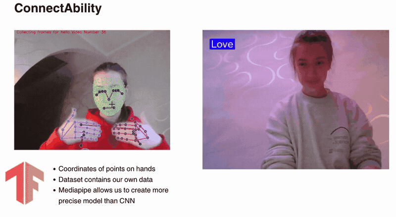
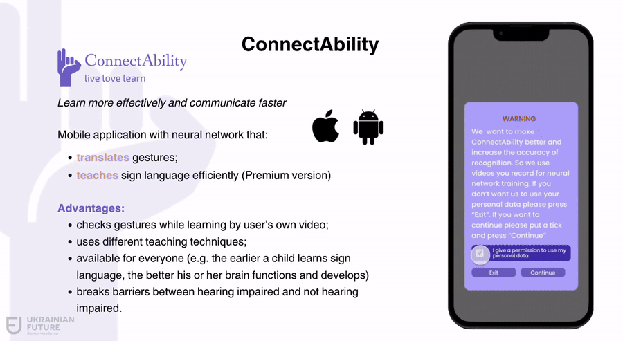
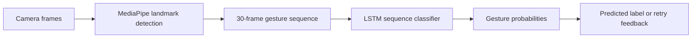

# ConnectAbility

### Ukrainian Sign Language learning · Gesture recognition · Custom dataset collection

**ConnectAbility** is a project for learning and practising Ukrainian Sign Language, with camera-based recognition to help learners check the gestures they perform. It brings together a learning-app prototype and a machine learning pipeline that classifies short gesture sequences.

## My contribution

**Sofia Stoliar · [@Sofiafgx](https://github.com/Sofiafgx)**

**Focus: sign language recognition model development and dataset collection.**

I worked on the machine learning component of the project: **collecting a custom gesture dataset and developing the sign language recognition model**. My work connected recorded gesture examples with a model that learns movement patterns from sequences of hand landmarks.

| Area | What my work involved |
| :--- | :--- |
| **Dataset collection** | Collecting labelled gesture examples and preparing frame sequences for model training. |
| **Recognition model** | Developing an LSTM-based classifier for recognising gestures from landmark sequences. |

The implementation below shows the data collection, landmark extraction, training, evaluation, and webcam prediction workflow. The app prototype provides context for how recognition can support a learner's practice.

**Technologies:** Python · TensorFlow / Keras · MediaPipe · OpenCV · NumPy · scikit-learn · Jupyter.

[Watch the demos](#project-demos) · [Explore the model](#how-recognition-works) · [Dataset](#dataset-and-gesture-vocabulary) · [Browse the code](#where-to-start-in-the-code)

## Project demos

### 1. Dataset collection and gesture recognition

The recording shows webcam-based data collection on the left and a recognition demonstration on the right. Landmark overlays make the captured movement visible, while predicted labels illustrate the classification step.

[](assets/demos/dataset-and-recognition.mp4)

**[Open the full recording · MP4 · 25 seconds](assets/demos/dataset-and-recognition.mp4)**

### 2. Learning-app prototype

The prototype walkthrough shows onboarding, a camera interface, a prompt to record a gesture, and an example of gesture practice. It illustrates the intended learning experience around the recognition component.

[](assets/demos/learning-app-prototype.mp4)

**[Open the full recording · MP4 · 30 seconds](assets/demos/learning-app-prototype.mp4)**

The animated previews show excerpts; the MP4 files contain the complete supplied recordings. The demonstrations document different stages of the project, so the gesture labels shown in a video may differ from those in a saved model experiment.

## What the project is designed to do

The learning flow is straightforward: a learner studies a gesture, performs it in front of a camera, and receives recognition feedback to help check their practice. The broader goal is to make Ukrainian Sign Language practice more accessible and interactive.

The recognition prototype classifies a **small, predefined vocabulary of gestures**. Expanding that vocabulary and evaluating recognition across more signers are further development steps.

## How recognition works



### From video to features

MediaPipe detects landmarks, and OpenCV handles camera capture and visual feedback. In the hand-focused experiment, each frame is represented by **126 values**:

```text
21 landmarks per hand × 3 coordinates × 2 hands = 126 features
30 consecutive frames = one gesture sequence
```

Missing hand detections are represented by zero-filled vectors. The LSTM processes the sequence to learn how the landmarks move over time, rather than classifying a single still frame.

### Saved model architecture

The configuration stored in [`action.h5`](action.h5) contains:

```text
Input: 30 frames × 126 landmark features
                    ↓
LSTM: 64 units, returns a sequence
                    ↓
LSTM: 128 units, returns a sequence
                    ↓
LSTM: 64 units
                    ↓
Dense: 64 units → Dense: 32 units
                    ↓
Softmax: 2 gesture classes
```

The hidden layers use ReLU activations. The notebook trains with Adam and categorical cross-entropy. Its interactive prediction cell records a sequence after pressing **R**, then displays a class label when the prediction exceeds its confidence threshold, or **“Try again”** otherwise.

## Dataset and gesture vocabulary

The collection workflow records gestures by class, extracts landmarks from each frame, and saves the resulting arrays in a structure such as:

```text
MP_Data/
└── <gesture label>/
    └── <sequence number>/
        ├── 0.npy
        ├── ...
        └── 29.npy
```

Saved outputs in the hand-focused notebook show an experiment with **100 sequences**, **30 frames per sequence**, and **126 features per frame**. Its recorded label map contains:

| Notebook label | English meaning |
| :--- | :--- |
| `Vsih vitay` | Greeting everyone |
| `Diakuy vam` | Thank you |

These are the notebook's transliterated labels. The repository also preserves an earlier full-body landmark experiment with a different vocabulary and input size.

The raw `MP_Data` arrays are not included in this repository. The code documents the collection process; the saved outputs describe particular experiments rather than a complete dataset inventory.

## Where to start in the code

| File | What to review |
| :--- | :--- |
| [Action Detection Tutorial.ipynb](Action%20Detection%20Tutorial.ipynb) | Hand-landmark experiment: collection setup, 126-feature representation, LSTM training, evaluation, and a record-and-predict webcam interface. |
| [Action Detection Refined.ipynb](Action%20Detection%20Refined.ipynb) | Earlier experiment using pose, face, and both hands: 1,662 features per frame and three output classes. |
| [action.h5](action.h5) | Saved Keras model with a `30 × 126` input and two output classes. |
| [Logs/](Logs/) | TensorBoard training logs from development runs. |
| [assets/demos/](assets/demos/) | Complete MP4 recordings and animated previews. |

### Reviewing or continuing the experiments

Open the notebooks in Jupyter to inspect the collection process, model architecture, and saved outputs. A webcam and a compatible Python environment are needed for capture and interactive prediction. The imports use TensorFlow/Keras, MediaPipe's Holistic API, OpenCV, NumPy, scikit-learn, Matplotlib, and Pillow.

The notebooks preserve development history, including alternative configurations and debugging cells. Before rerunning, align the gesture labels, landmark extractor, input dimensions, and model checkpoint. See the [experiment notes](docs/experiment-notes.md) for the specific differences.

Evaluation cells include confusion matrices and accuracy calculations on small development splits. Broader evaluation with unseen signers, lighting conditions, and backgrounds remains a next step.

## Skills demonstrated

- **Computer vision:** converting webcam observations into structured hand-landmark features.
- **Dataset development:** collecting labelled gesture sequences and organising temporal training data.
- **Deep learning:** modelling gesture motion with a stacked LSTM classifier.
- **Applied machine learning:** connecting capture, prediction, and visual feedback to a learning use case.

The repository focuses on the recognition experiments and saved model. The mobile interface is documented through the prototype recording; mobile app source code is not included here.
